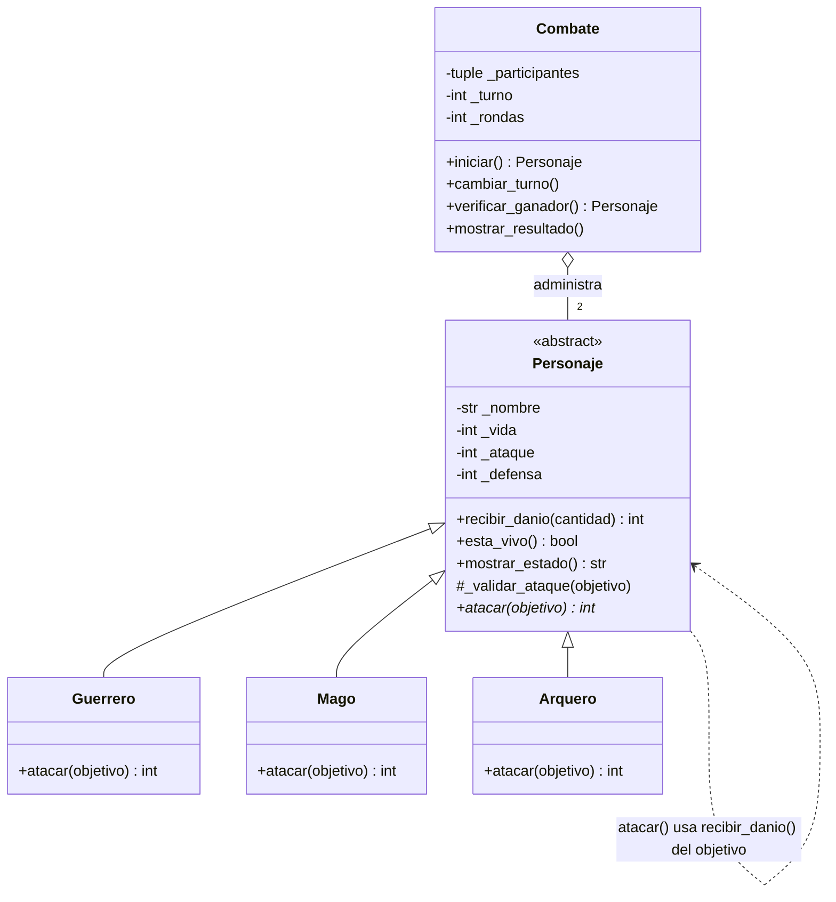

# Guardians of the Ancient Kingdom

Sistema de combate por turnos en Python para la asignatura de Programación Orientada a Objetos.

## 1. Descripción

En el reino de Eldoria hay tres órdenes de guardianes: Guerreros, Magos y Arqueros. Todos tienen nombre, vida, ataque y defensa, pero cada orden pelea a su manera. El programa enfrenta a dos guardianes por turnos, calcula el daño según la habilidad de cada uno, actualiza su vida y decide solo quién gana (o si hay empate).

El problema que resuelve es modelar personajes que comparten datos y reglas pero se comportan distinto, y hacerlo de forma que agregar un nuevo tipo de guardián no obligue a tocar la lógica del combate.

## 2. Estructura

```text
Guardians-of-the-Ancient-Kingdom/
├── personajes.py        # Definición de las clases (no ejecuta nada al importarse)
├── main.py              # Crea objetos, ejecuta combates y los 12 casos de prueba
├── test_personajes.py   # Pruebas automatizadas con Pytest (Reto 2)
└── README.md            # Esta documentación
```

- **`personajes.py`**: `Personaje` (abstracta), `Guerrero`, `Mago`, `Arquero` y `Combate`, con constructores, atributos encapsulados, getters, setters, validaciones y lógica.
- **`main.py`**: importa las clases y demuestra que funcionan: crea personajes, ataca, pelea un combate completo y muestra `[OK]` o `[FALLO]` en cada caso obligatorio.
- **`test_personajes.py`**: las mismas reglas, pero como pruebas repetibles que se ejecutan con un solo comando.

## 3. Clases

- **`Personaje`**: guarda lo común (nombre, vida, ataque, defensa), valida esos datos y sabe recibir daño, decir si sigue vivo y mostrar su estado. Obliga a las hijas a implementar `atacar()`.
- **`Guerrero`**: *Golpe poderoso*. Su ataque sube 20 % antes de restar la defensa del objetivo.
- **`Mago`**: *Hechizo penetrante*. Su daño es su ataque completo, sin importar la defensa.
- **`Arquero`**: *Disparo crítico*. Si su ataque supera la defensa del objetivo, el daño (ataque − defensa) se duplica; si no, es 0.
- **`Combate`**: no es un personaje. Recibe a dos ya creados, lleva los turnos, muestra el estado tras cada ataque, detecta al ganador o el empate y presenta el resultado.

## 4. Relaciones

- **Herencia (es un)**: `Guerrero`, `Mago` y `Arquero` *son* un `Personaje`. Se usó para no repetir atributos y validaciones en las tres clases.
- **Asociación (usa a)**: cuando un personaje ejecuta `atacar(objetivo)`, interactúa con otro objeto llamando a su método `recibir_danio()`. Ninguno es dueño del otro; solo colaboran.
- **Agregación (tiene a)**: `Combate` *tiene* dos personajes, pero ellos se crean fuera (en `main.py`) y siguen existiendo cuando el combate termina. Por eso se pasan por el constructor en vez de crearse dentro.

## 5. Conceptos de POO en el programa

- **Abstracción**: `Personaje` hereda de `ABC` y declara `atacar()` con `@abstractmethod`. No se puede crear un `Personaje` genérico (la prueba `test_personaje_es_abstracto` lo comprueba).
- **Encapsulamiento**: los datos viven en atributos privados (`_vida`, `_ataque`...) y solo se tocan mediante propiedades (getters/setters) que validan. Por ejemplo, `vida` rechaza 101, -1 o un texto; el nombre vacío lanza `ValueError`.
- **Herencia**: las subclases reciben gratis constructor, validaciones, `recibir_danio()`, `esta_vivo()` y `mostrar_estado()`, y solo escriben lo que las distingue.
- **Polimorfismo**: `Combate.iniciar()` llama `atacante.atacar(defensor)` sin saber si el atacante es Guerrero, Mago o Arquero; cada objeto ejecuta su versión. No hay ningún `if tipo == ...` en el código del combate.

## 6. Lógica del combate

**Daño** (siempre entero y nunca negativo):

| Clase | Fórmula |
|---|---|
| Guerrero | `max(0, ataque × 120 // 100 − defensa)` (la división entera redondea hacia abajo) |
| Mago | `ataque` |
| Arquero | `(ataque − defensa) × 2` si `ataque > defensa`; si no, `0` |

`atacar()` valida (atacante vivo, objetivo válido y vivo, no atacarse a sí mismo), calcula el daño y llama a `objetivo.recibir_danio(daño)`. Ese método **no vuelve a restar la defensa**, impide la vida negativa y devuelve el daño efectivo realmente recibido (por eso el último golpe del ejemplo es "20 efectivo").

**Turnos**: una *ronda* son dos ataques, uno de cada personaje, empezando por el primero que se pasó al `Combate`. Tras cada ataque se imprime el estado de ambos y se llama a `verificar_ganador()`. Si nadie ha caído, `cambiar_turno()` alterna al atacante. El combate termina cuando:

1. la vida de un participante llega a 0 (gana el otro);
2. una ronda completa transcurre sin daño (**empate técnico**); o
3. se completan 50 rondas sin ganador (**empate**).

Resultado del ejemplo del enunciado (Arthas, Guerrero 100/30/20, contra Gandalf, Mago 80/40/10): daños 26, 40, 26, 40, 26 y 20 efectivo; Arthas queda con 0 y Gandalf con 2. **Ganador: Gandalf.**

## 7. Ejecución

Requiere Python 3.8 o superior.

```bash
git clone https://github.com/<tu-usuario>/Guardians-of-the-Ancient-Kingdom.git
cd Guardians-of-the-Ancient-Kingdom
python main.py
```

Para las pruebas automáticas:

```bash
pip install pytest
pytest -v
```

## 8. Pruebas

`python main.py` ejecuta los 12 casos obligatorios y termina con `Resumen: 21/21 comprobaciones correctas`:

| # | Caso | Resultado |
|---|---|---|
| 1 | Creación de los tres tipos | OK |
| 2 | Vida 101 y -1 rechazadas | OK (`ValueError`) |
| 3 | Nombres vacíos rechazados | OK (`ValueError`) |
| 4 | Ataque 0/negativo, defensa negativa, tipo incorrecto | OK |
| 5 | Guerrero: 30 vs defensa 10 → 26 | OK |
| 6 | Mago: 40 ignora defensa 20 → 40 | OK |
| 7 | Arquero: 35 vs 15 → 40; sin ventaja → 0 | OK |
| 8 | 50 de daño a 20 de vida → vida 0, efectivo 20 | OK |
| 9 | Derrotado no ataca ni puede ser atacado | OK (`ValueError`) |
| 10-11 | Combate completo; gana Gandalf con 2 de vida | OK |
| 12 | Dos arqueros sin daño → empate técnico | OK |

### Pytest (Reto 2)

**Pytest** es un framework que descubre funciones `test_*` y comprueba con `assert` que el código cumple sus reglas, de forma repetible y con un informe claro. Aquí `test_personajes.py` cubre: creación válida, rechazo de valores incorrectos, daño de cada clase (incluido el redondeo hacia abajo), vida nunca negativa, derrotados que no atacan y resultado del combate (ganador, empate técnico y empate por 50 rondas).

```bash
pip install pytest
pytest -v
```

Resultado de la ejecución:

```text
<< Pega aquí la salida real de `pytest -v` en tu computador >>
```

## 9. Diagrama de clases UML (Reto 1)

Un **diagrama de clases UML** muestra las clases de un sistema (con sus atributos y métodos) y cómo se relacionan, para entender la arquitectura antes de leer el código. Cada caja tiene tres partes: nombre, atributos y métodos; `-` indica privado y `+` público. La clase abstracta y su método abstracto van en cursiva.



- Las flechas con triángulo vacío (`<|--`) son **herencia**.
- El rombo vacío (`o--`) es **agregación**: `Combate` agrupa dos `Personaje` que existen por su cuenta.
- La flecha punteada (`..>`) es **asociación/dependencia**: un personaje usa a otro al atacar.
- `atacar()` está marcado con `*` en `Personaje` (abstracto) y reaparece implementado en cada hija.

## 10. Reto de abstracción

**¿Por qué `atacar()` es abstracto, pero `recibir_danio()` está implementado en la clase base?**

`Personaje` tiene la responsabilidad de representar lo que es verdad para *todo* guardián: tener nombre, vida, ataque y defensa, estar vivo o derrotado, y sufrir daño. No debería conocer cómo pelea cada orden, porque eso cambia de una a otra.

`recibir_danio()` es igual para todos. Recibe una cantidad ya calculada, no acepta negativos, descuenta vida sin bajar de 0 y devuelve el daño efectivo. Un Mago con 20 de vida que recibe 50 queda en 0 igual que un Arquero; ninguna regla depende del tipo. Escribirlo una vez en la clase base evita copiarlo tres veces (y que una copia tenga un error que las otras no), y las hijas lo reutilizan por herencia.

`atacar()` es lo contrario: la pregunta "¿cuánto daño hago?" tiene tres respuestas distintas. El Guerrero hace `ataque × 1.20 − defensa`, el Mago hace `ataque` ignorando la defensa y el Arquero duplica `ataque − defensa` si supera la defensa. No existe una versión general razonable que ponerle a `Personaje`; lo único común es *que todos deben poder atacar*. Marcarlo `@abstractmethod` expresa ese contrato y obliga a cada subclase a implementarlo: si alguien crea un `Curandero` y olvida `atacar()`, Python no deja instanciarlo.

Esto se conecta con los tres conceptos:

- **Abstracción**: la clase base define *qué* puede hacer un personaje (`atacar`) sin decir *cómo*.
- **Herencia**: reutiliza lo común (`recibir_danio`, `esta_vivo`, validaciones) y deja que las hijas añadan lo propio.
- **Polimorfismo**: `Combate` ejecuta `atacante.atacar(defensor)` sobre cualquier `Personaje` y cada uno responde con su fórmula. Para añadir un nuevo guardián basta con crear otra subclase que implemente `atacar()`; `Combate` no se modifica.
